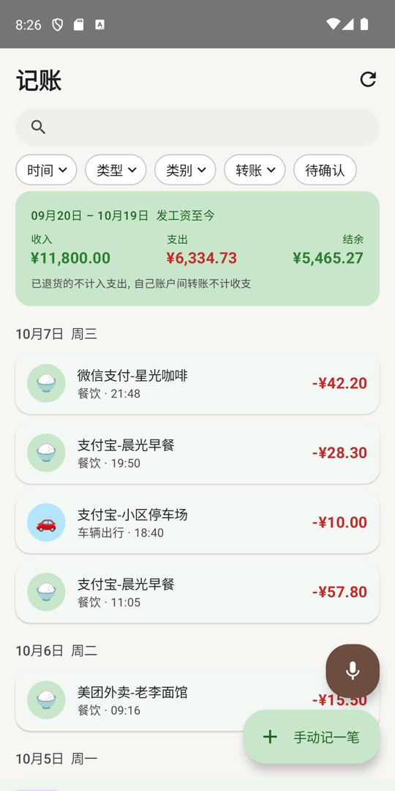
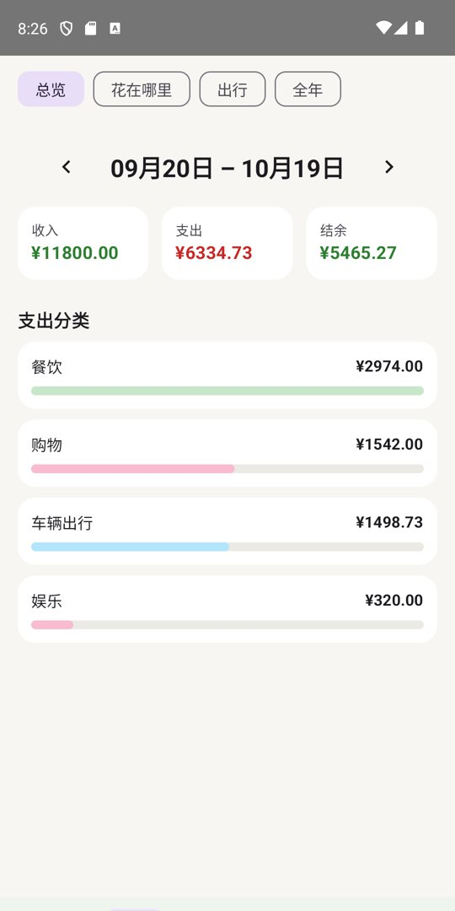
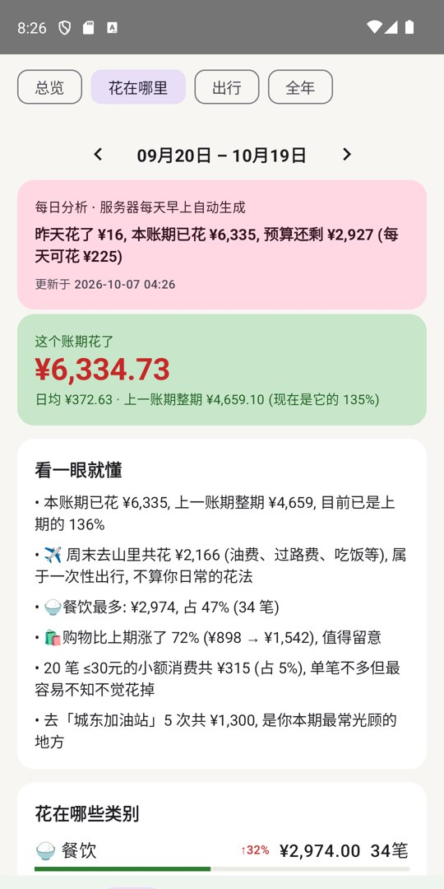
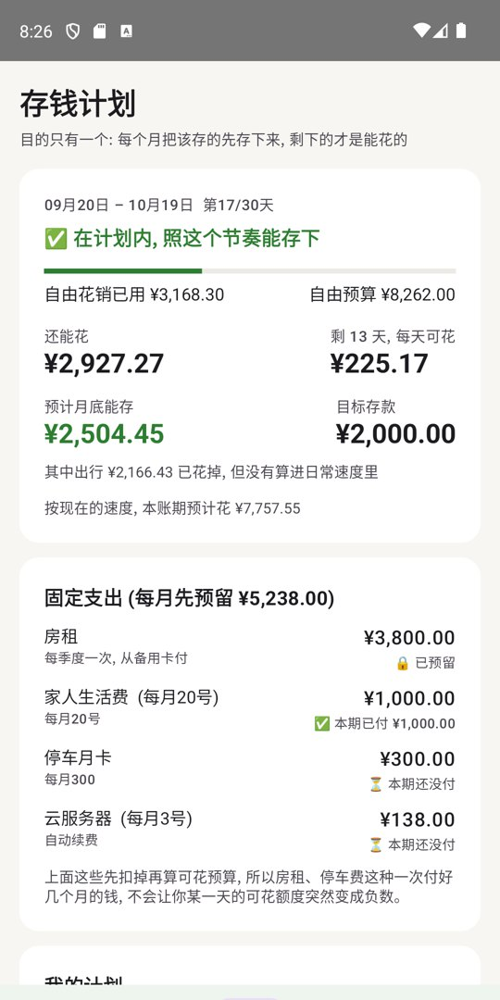
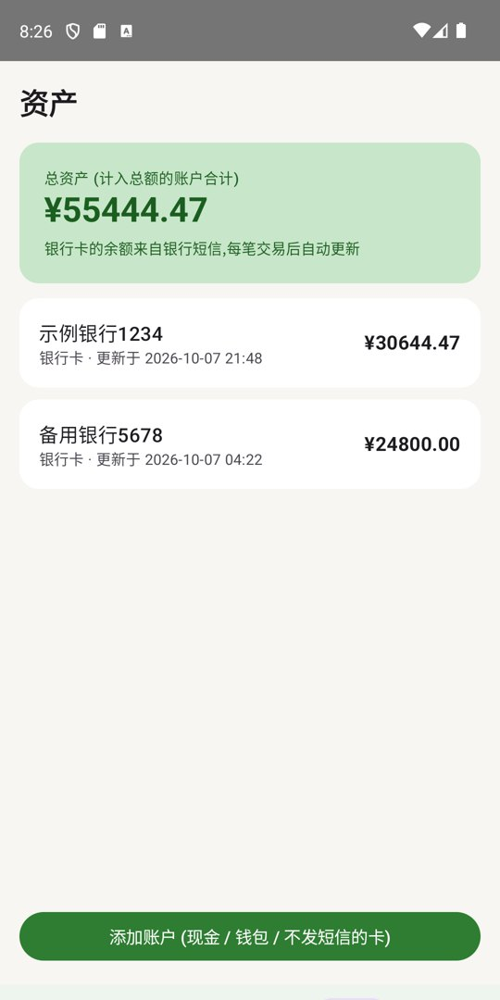
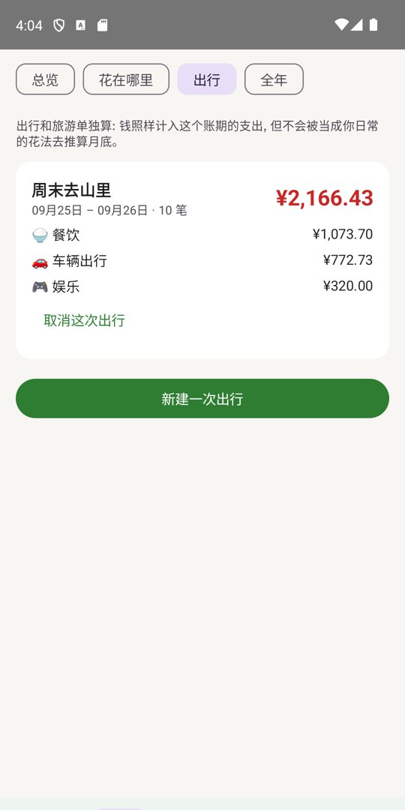

# Ledger

<p align="center">
  <a href="README.md">简体中文</a> | <b>English</b>
</p>

A family bookkeeping app for people who give up on bookkeeping apps: **you never enter anything by hand.** Payment notifications from WeChat / Alipay and bank SMS become transactions on their own, refunds cancel the purchase they belong to, transfers between your own accounts are not counted as income or spending, months run from payday to payday, there is a savings plan, and the server writes a spending analysis every morning. The backend is Python (FastAPI + Postgres) running on a box at home (a NAS, a Raspberry Pi...), the Android app is Kotlin + Jetpack Compose.

I tried several bookkeeping apps and quit each within a month: every purchase has to be typed in and then reconciled. This project has one goal: **make the bookkeeping happen by itself.**

It was written entirely in pair-programming with [Claude Code](https://claude.com/claude-code).

> A personal project: no store listing, no promise of long-term maintenance. It has only been run on real hardware with one Xiaomi phone and SMS from two Chinese banks (CCB, Bank of Communications). Other banks need a parser rule, see [Adapting it to your bank](#adapting-it-to-your-bank).

<p align="center">
  
  
  
  
  
  
</p>
<p align="center"><sub>All transactions in the screenshots are made-up demo data. The app UI is in Chinese.</sub></p>

---

## Contents

- [Features](#features)
- [How it works](#how-it-works)
- [Quick start](#quick-start)
- [Permissions on the phone](#permissions-on-the-phone)
- [Privacy and security](#privacy-and-security)
- [Adapting it to your bank](#adapting-it-to-your-bank)
- [Build from source](#build-from-source)
- [Project layout](#project-layout)
- [Known limitations](#known-limitations)
- [License](#license)

## Features

- **Automatic capture**: the phone forwards the raw text of WeChat / Alipay payment notifications and bank SMS to your own server, which parses it. Missed or cleared notifications are recovered from the SMS inbox; offline captures are queued and uploaded later, never lost, never duplicated.
- **One payment, one record**: the same purchase reported by a WeChat notification and by a bank SMS is merged; a re-sent message is never counted twice.
- **Refunds cancel spending**: a refund is paired with the original purchase (partial and split refunds supported), which stops counting as spending, in the pay cycle of the purchase.
- **Transfers are not income or spending**: moves between your own accounts and credit-card repayments are ignored.
- **Account balances** read from the "available balance" in bank SMS; cash / wallets / cards without SMS can be added by hand.
- **Pay cycles instead of calendar months**: a cycle starts on a day you choose (say the 20th). A variable salary is fine: before payday the plan uses the lowest of your last three salaries, afterwards the real one.
- **Savings plan**: set how much to save each cycle; fixed commitments (rent, family allowance, parking...) are reserved first, the rest is the free budget. It tells you what is left, how much per day, and what you will have saved at the current pace.
- **Daily analysis written by the server**: yesterday's spending, budget left, unusual purchases, likely subscriptions. A push notification arrives every morning; you never have to ask for it.
- **Where did it go**: category shares and changes, daily / weekly bars (**tap a bar to see that day's or week's purchases**), top shops, biggest purchases (**tap one to change its category**). Every number drills down to the underlying records, sortable by time or amount.
- **Trips tracked separately**: create a trip (a weekend away, the National Day drive home); fuel, tolls, parking, meals and tickets in that date range are filed under it. The money still counts in the cycle, but is not extrapolated into the "pace" forecast. The server also suggests likely trips from tolls, hotels and tickets.
- **Learns your categories**: change a record's category once and that shop is filed the same way from then on, whether you pay by WeChat or Alipay.
- **Filters, search, infinite scroll**: spreadsheet-style header drop-downs (time / type / category / transfers / needs review).
- **One-tap sync** without opening the app: a launcher shortcut and a Quick Settings tile.
- Voice entry, manual entry and a ledger shared by two people also work.

## How it works

```
WeChat / Alipay notifications + bank SMS
        │  the phone only forwards the raw text (local queue, safe offline)
        ▼
   your own server  /ingest ── parse, merge, pair refunds, categorise, update balances
        │
        ▼
   Postgres ── plan / analysis / daily report ← read by the app
```

Parsing lives on the **server**, so fixing a rule or adding a bank **does not need a new app release**. Anything that looks like a payment but matches no rule is stored verbatim (`/ingest/failed`) so you can write the rule from a real sample.

## Quick start

### 1. Backend

Any machine that is always on (NAS, Raspberry Pi, router, VPS) plus Docker:

```bash
git clone https://github.com/EdgeN8v/Ledger.git
cd Ledger
cp .env.example .env
# edit .env: set POSTGRES_PASSWORD and a long random JWT_SECRET
docker compose up -d --build
curl http://localhost:8000/health        # {"status":"ok"}
```

**Registration is closed by default**, so strangers cannot create accounts on your server. To create the first accounts, add `REGISTRATION_OPEN=true` to `.env`, restart, register yourself and your family in the app, then remove the line and restart again.

See [docs/deployment_EN.md](docs/deployment_EN.md) for deployment, reaching the server from your phone, and backups.

### 2. App

Download the latest `Ledger-vX.X-debug.apk` from [Releases](../../releases) and install it (allow "install unknown apps"). It is **debug-signed**: it installs and runs, nothing more.

On the login screen enter your server address (e.g. `http://192.168.1.10:8000/`), choose "create ledger"; a second person joins with the ledger invite code shown on the "我的" (Me) tab.

### 3. Plan

Bottom tab "计划" (Plan) → edit the plan: how much to save per cycle and your fixed commitments. Leave monthly income empty: it is derived from your salary SMS.

## Permissions on the phone

Automatic capture needs two system permissions that only you can grant:

1. **Notification access**: Me tab → Auto bookkeeping → enable → switch "记账" on.
2. **Read SMS** (to recover anything the notification path missed): same page.

On Xiaomi / many Chinese ROMs also: set the app's battery policy to "no restrictions" and allow autostart; if the system says "restricted setting", open App info → ⋮ → "Allow restricted settings" and enable notification access again; and allow reading *notification SMS* in the permissions, otherwise bank messages are hidden from third-party apps.

## Privacy and security

- The app **reads your payment notifications and SMS**. Everything is sent **only to the server you run**; there is no third-party service, analytics or cloud.
- Digit runs longer than 12 characters (ID or account numbers that some bank messages echo) are masked before anything is stored.
- Registration is off by default, invite codes are random, and the server refuses to start with the placeholder JWT secret.
- **Do not forward port 8000 to the internet.** The data is sensitive and the service speaks plain HTTP. Use it on your LAN and reach it from outside through a VPN (WireGuard / Tailscale...); if you must expose it, put it behind a TLS reverse proxy.
- Back up. `docker-compose.yml` ships a small container that dumps the database every night and keeps 14 dumps; copy that folder somewhere else as well.

## Adapting it to your bank

Bank SMS wording differs between banks. CCB and Bank of Communications are verified (see `backend/app/parsers.py`). If yours is not recognised:

1. See what failed to parse: `GET /ingest/failed` (authenticated), or the rows of `raw_events` with `status = 'failed'`.
2. Add a rule in `backend/app/parsers.py` following the existing ones; `backend/tests/test_ingest.py` shows how to test it.
3. Issues and PRs are welcome, **but please mask real names, card numbers and amounts first**.

## Build from source

**Backend tests**

```bash
cd backend
python -m venv .venv
.venv/bin/pip install -r requirements.txt pytest httpx      # Windows: .venv/Scripts/pip
.venv/bin/python -m pytest tests                             # 43 tests
```

**Android**: open `android/` in Android Studio, or `./gradlew assembleDebug`. The default server address is a placeholder; to bake in your own, put this in `android/local.properties` (never committed):

```properties
ledger.defaultServer=http://192.168.1.10:8000/
ledger.lanServer=http://192.168.1.10:8000/
```

## Project layout

```
backend/    FastAPI + SQLAlchemy backend (parsing, merging, refund pairing, plan, analysis, daily report)
android/    Kotlin + Jetpack Compose app (notification listener, upload queue, screens)
docs/       deployment notes, backup script, screenshots
```

## Known limitations

- Android only. Parsers are verified for CCB, Bank of Communications and Alipay; WeChat Pay is mostly covered through the bank SMS.
- Accounts that send no SMS (for example rent paid from another card) have to be set up by hand in the plan.
- Categories come from keywords plus your corrections, not from an AI; fix a shop once and it is learned.
- No iOS version and no store release planned.

## License

[MIT](LICENSE)
